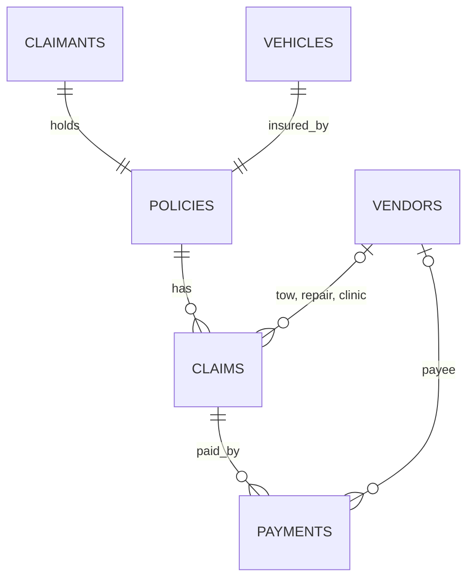

# Synthetic claims world (generator v1)

All data is synthetic. Columns, types and rules are defined in
[`data/contracts/claims_world_v1.yaml`](../../data/contracts/claims_world_v1.yaml),
which is the single source of truth; this page explains the shape.

## Tables and links



| Table | Rows (default) | Key | Notes |
|---|---|---|---|
| policies | 60,000 | policy_id | one claimant and one vehicle per policy |
| claimants | 60,000 | claimant_id | PII columns are masked in silver |
| vehicles | 60,000 | vehicle_id | VIN is treated as PII |
| vendors | 1,000 | vendor_id | 300 tow, 500 repair shops, 200 clinics |
| claims | 100,000 | claim_id | loss within policy period; report after loss |
| payments | about 108,000 | payment_id | closed_paid claims only; total never above claimed |

## Outcome columns
`claims.status`, `claims.fraud_label` and all of `payments` are outcomes
(`known_at_scoring: false`). They must never be used as model features.
`fraud_label` is set only for investigated claims (about 15 percent).

## Run it
```
python -m data.generators.claims_world --seed 42 --n-claims 100000 --out .local/claims_world
```
Same seed and settings always give byte-identical files. Output goes to `.local/`,
which git ignores.

## Not yet included
Planted fraud rings (#10) and realistic data mess (typos, duplicates, late records).